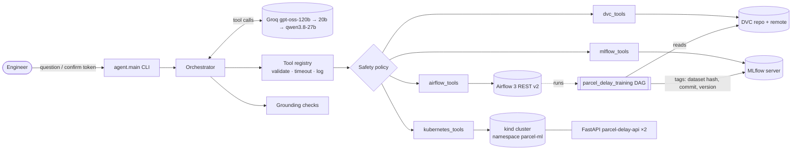

# Architecture

## 1. System overview

The agent is a **tool-calling loop**, not a chatbot: the LLM picks tools, the registry executes them with validated
arguments and a timeout, and every result becomes numbered **evidence** (`E1`, `E2`, …). The final answer is checked
against that evidence before it is returned.

## 2. Components

| Component | Responsibility |
|---|---|
| `agent/orchestrator.py` | Conversation loop; coverage checks; confirmation handling; answer finalisation |
| `agent/registry.py` | Tool declaration (`@tool`), JSON schemas for the LLM, argument validation (unknown fields rejected), thread-pool execution with per-tool timeout, uniform `ToolResult` |
| `agent/policy.py` | Approved namespace/DAG/DVC commands, two-step confirmation tokens, training-intent check |
| `agent/grounding.py` | Verifies citations and numeric values/ids in an answer against tool output |
| `agent/llm.py` | Groq and Gemini over OpenAI-compatible endpoints; per-model fallback; rate-limit handling |
| `agent/logging_utils.py` | JSON logs (tool, status, duration, request id) with secret redaction |
| `agent/tools/*` | The four required modules plus `assessment_tools` (cross-system retraining policy) |

## 3. Data and provenance flow

1. `make_data.py` produces versioned datasets; **DVC** stores them, **git tags** (`dataset-v1..v3`) name them.
2. Training (CLI or Airflow) writes `dataset_version`, `dataset_md5`, `dataset_git_commit` and
   `dataset_file_matches_pointer` as **MLflow tags**; the version is resolved from the data hash, so it stays correct
   even when an older pointer is checked out.
3. "Which dataset did experiment 25 use?" is answered from those recorded tags, never from memory.
4. Only a run that **passed the Airflow quality gate** may be exported into the serving image.

## 4. Training DAG

`validate_data → preprocess → train_model → evaluate_and_log → quality_gate → promote_candidate`

* **Validation** checks schema, nulls, row count, label rate and that the file hash equals its DVC pointer.
* **Quality gate** requires F1, recall and ROC-AUC thresholds (DAG params). Failure raises a non-retryable error.
* **Promotion** only sets the registry alias `candidate`; a human still decides to deploy.
* Retries (2, 15 s) apply to infrastructure errors; deterministic failures (exit code 2) are not retried.
* Stages run in an isolated virtualenv in the Airflow image, so Airflow's dependencies never constrain the model's.

## 5. Kubernetes workload

Deployment `parcel-delay-api` (2 replicas, rolling update) with startup, readiness (`/ready`, 503 until the model
loads) and liveness (`/health`) probes, CPU/memory requests and limits, ConfigMap-based settings, non-root user;
ClusterIP Service on port 80 → 8000.

## 6. Tools and permissions

| Module | Tool | Access |
|---|---|---|
| MLflow | `list_experiments`, `list_runs`, `get_run_details`, `find_best_run`, `compare_runs`, `compare_experiments`, `get_model_registry` | read |
| DVC | `dvc_list_datasets`, `dvc_current_version`, `dvc_detect_changes`, `dvc_compare_versions`, `dvc_reproduce_instructions`, `get_dataset_for_run` | read; only allow-listed commands (`status`, `diff`, `list`, `remote list`) |
| Airflow | `airflow_list_dags`, `airflow_get_dag_runs`, `airflow_get_run_status`, `airflow_identify_failed_tasks`, `airflow_get_task_diagnostics` | read; approved DAG only |
| Airflow | `airflow_trigger_training` | **write**; approved DAG only, and only if the user's own message asks to train/run |
| Kubernetes | `k8s_list_deployments`, `k8s_list_pods`, `k8s_get_pod_status`, `k8s_get_pod_logs`, `k8s_list_services`, `k8s_find_unhealthy_pods`, `k8s_get_deployed_version`, `k8s_get_config` | read; approved namespace only |
| Kubernetes | `k8s_request_restart`, `k8s_request_scale` | **request only**: returns a single-use token, expires in 120 s |
| Kubernetes | `k8s_apply_confirmed` | **hidden from the LLM**; callable only on the human `confirm <token>` path |
| Assessment | `assess_retraining_need` | read; recommends only, never triggers training |

## 7. Safety and reliability design

* **Two-step cluster changes.** The model can request, not execute. Even though it can see the token, the executor is
  a hidden tool the registry refuses to run for model-originated calls. Scope is re-checked at execution time.
* **No automatic retraining.** Trigger intent is checked against the *user's* message in code, not just the prompt.
* **Evidence-first answers.** If no tool succeeded but the draft states operational facts, the draft is discarded. Tool
  failures are always appended verbatim. Unsupported numbers/ids or unknown citations produce a visible warning.
* **Coverage guarantees.** Questions spanning three or more systems, and "why is X failing" questions, must use the
  relevant tools; the orchestrator nudges the model and, if ignored, runs the missing read-only tools itself.
* **Structured answers.** Combined/diagnostic answers must separate Known facts, Uncertainties and Recommended actions.
* **Failure containment.** Timeouts per tool, no retries that hide outages (MLflow client retries set to 0), model and
  provider fallback with honest degradation when no LLM is reachable.
* **Observability.** One JSON line per tool call: `request_id`, `tool`, `status`, `duration_ms`, `evidence_id`; keys,
  tokens and passwords are redacted before writing.

## 8. Design decisions

| Decision | Why |
|---|---|
| Direct tool calling instead of an agent framework | Full control over validation, confirmation and grounding; easy to test with a scripted model |
| Own synthetic dataset with deliberate drift | Reproducible offline; gives dataset comparison and retraining logic real material |
| Provenance in MLflow tags keyed by data hash | Survives checkouts of older versions; answers "which data trained this?" without trusting the working tree |
| Model baked into the image, gated by the quality gate | Immutable, reproducible deployment; the agent explains that a restart does not change the model |
| Airflow stages in an isolated virtualenv | No dependency conflicts between Airflow and the ML stack |
| Retraining assessment as deterministic code | Evidence-based policy (freshness, drift, failed gate, supplied degradation) instead of LLM opinion |
